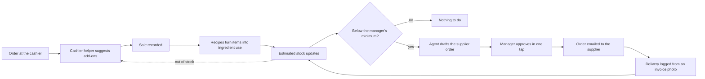

<div align="center">


# Restaura

**AI agents that run the two jobs every restaurant forgets to do on a busy day:**<br>
**sell a little more at the cashier, and never run out of what you sell.**


</div>

---

## The problem

A restaurant has two daily jobs that depend on someone remembering to do them.

- **At the cashier**, a good upsell only happens if the cashier thinks of it.
- **Behind the counter**, the manager has to work out from sales how much of each ingredient was used, notice what is running low, and place supplier orders in time.

When either step is missed, sales are lost or an item runs out in the middle of service.

## The solution

Restaura is a web app, responsive on laptop and phone, with an AI agent that **owns each process end to end**. The manager stays in control: agents act on their own for everything routine, and ask for approval only when money is spent or a record changes.



## Meet the agents

### 1. Cashier helper
Works while the order is being taken.

- Suggests add-ons and upgrades that fit what is already in the order
- Hides items that are out of stock, so a customer is never sold what the kitchen can't make
- Shows the manager, in real time, what is helping sales

### 2. Stock-to-order agent
Works after the branch closes.

| Step | What the agent does | Who acts |
| --- | --- | --- |
| Read the day | Takes the day's sales from the POS | Agent |
| Convert | Uses each item's recipe to work out ingredient use | Agent |
| Track | Keeps an estimated stock level per ingredient | Agent |
| Notice | Flags ingredients below the minimum the manager set, or that will run out before the supplier can deliver | Agent |
| Draft | Writes the supplier order with quantities | Agent |
| Approve | One tap to approve or edit | **Manager** |
| Send | Emails the approved order to the supplier, or opens WhatsApp with the order typed in | Agent |
| Receive | Reads a photo of the supplier invoice to log the delivery (manual entry as a fallback) | Agent |
| Correct | A monthly physical count corrects the estimate | **Manager** |

### One shared brain
Both agents read and write the same database. What the cashier sells drives what the stock agent orders, and what the stock agent knows has run out disappears from the cashier's screen.

## More of the restaurant

These sections are built and share the same database. The manager overview writes its briefing with Claude when a key is set; the others run on rules today, and the most used ones become Claude agents next.

| Section | What it does |
| --- | --- |
| Manager overview | Reads every section and ranks what needs the manager first, with a short briefing |
| Forecast | Next 7 days of sales (recent level adjusted for the weekday, chosen by backtest), tomorrow's prep and which ingredients will run out |
| Expenses | Monthly and one-off costs, supplier deliveries at cost, and estimated profit |
| Routines | Opening, mid-shift and closing checklists ticked on the cashier iPad |
| Staff | PIN clock-in on the cashier iPad, shifts, lateness and hours worked |
| Supplier messaging | Orders by email or WhatsApp |

## Principles

- **Agents own a process, humans own decisions.** Anything that spends money or changes a record waits for approval.
- **Grounded, not invented.** Agents work from the store's own sales, recipes and invoices.
- **Explainable.** Every suggestion and every order shows why it was made.

## Evaluation

Every agent is tested on data it has not seen and compared with a simple method a person could use instead.
One command runs it all and writes the report; CI runs it on every push.

```bash
cd backend
pip install -e ".[dev,eval]"
python -m pytest          # 66 tests: features, robustness, and regression checks on the evaluation
python -m evals           # held-out evaluation, rules only (no key needed)
python -m evals --ai      # also the Claude path, with a small model to keep costs low
```

Latest run, from [`backend/evals/RESULTS.md`](backend/evals/RESULTS.md):

| Agent | Test | Simple method | Restaura |
| --- | --- | --- | --- |
| Cashier helper | Held-out week, store with its own pairing habits: one of 2 suggestions was really added | Best sellers 62.1% | Rules 86.6%, with Claude 88.2% |
| Forecast | Real U Walk sales, last 6 weeks, average error over the next 7 days (lower is better) | Same day last week 23.8% | 20.8% (previous method 26.4%) |
| Stock-to-order | Hand-worked scenario; 300 random stores | | 6/6 order lines exact; 100% recall and precision |
| Invoice reader | Drawn invoices with known values: clean, blurry, phone photo, smudged | | 100% of lines read right in every condition; never guessed a covered number |

The manager app shows the latest results under **More › Agent evaluation**, and can run the checks again from there.
`python -m evals --with-tests` also records which tests passed, for that page.

What the tests found and what changed because of them: [`backend/evals/IMPROVEMENTS.md`](backend/evals/IMPROVEMENTS.md).

## Status

In development. Runs as a demo for one store, using sample data, test recipes and a built-in demo cashier screen. Real supplier invoices and menus are not stored in this public repository.

## Run it

```bash
cd backend
pip install -e ".[dev]"
python -m uvicorn app.main:create_app --factory --port 8000
```

Open http://localhost:8000 and sign in. Each account gets its own screens:

| Account | Where it works | Screens |
| --- | --- | --- |
| `manager` | Any device, phone first | Today (overview), sales, supplier orders, stock, and under More: deliveries, forecast, expenses, routines, staff |
| `cashier` | Only on a device the manager paired as the cashier iPad | The cashier screen, staff clock-in and daily checklists |

Sample staff clock in on the iPad with PINs `1111` to `5555`. To pair the cashier iPad, sign in as the manager, tap **Pair a cashier iPad** and enter the 6-digit code on the iPad's sign-in page. Demo passwords come from `MANAGER_PASSWORD` and `CASHIER_PASSWORD` (see [`.env.example`](.env.example)); set your own before sharing the app. The app starts with sample data. Without `ANTHROPIC_API_KEY` the agents run in rules mode; set the key (see [`.env.example`](.env.example)) to switch them to Claude. Set `NIGHTLY_STOCK_CHECK=23:30` (store time) and the stock agent runs by itself after closing, so the draft orders are waiting for the manager's approval in the morning; nothing is sent without approval.


## Stack

| Layer | Technology |
| --- | --- |
| Backend | Python, FastAPI |
| Database | SQLite by default, PostgreSQL via `DATABASE_URL` |
| Web app | Responsive HTML, CSS and JavaScript served by the backend |
| Agents | Anthropic Claude API |

## Security

No keys or `.env` files are committed to this repository. The API key is supplied as an environment variable. See [`.gitignore`](.gitignore).

## Brand

Emerald `#0F2E26` · Brass `#C8A04A` · Cream `#F5EFE3` · a flat brass cloche. Logo files and usage rules are in [docs/BRAND.md](docs/BRAND.md).

---

<div align="center">

Built by **Yousef Samman**

</div>
