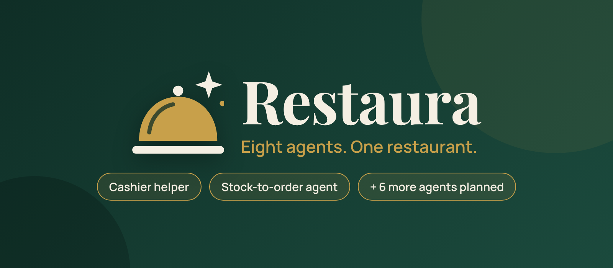
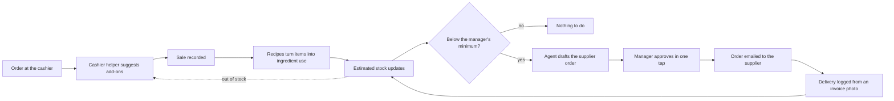

<div align="center">


# Restaura

**AI agents that run the two jobs every restaurant forgets to do on a busy day:**<br>
**sell a little more at the cashier, and never run out of what you sell.**




</div>

---

## The problem

A restaurant has two daily jobs that depend on someone remembering to do them.

- **At the cashier**, a good upsell only happens if the cashier thinks of it.
- **Behind the counter**, the manager has to work out from sales how much of each ingredient was used, notice what is running low, and place supplier orders in time.

When either step is missed, sales are lost or an item runs out in the middle of service.

## The solution

Restaura is a web app, responsive on laptop and phone, with an AI agent that **owns each process end to end**. The manager stays in control: agents act on their own for everything routine, and ask for approval only when money is spent or a record changes.



## Meet the agents

### 1. Cashier helper
Works while the order is being taken.

- Suggests add-ons and upgrades that fit what is already in the order
- Hides items that are out of stock, so a customer is never sold what the kitchen can't make
- Shows the manager, in real time, what is helping sales

### 2. Stock-to-order agent
Works after the branch closes.

| Step | What the agent does | Who acts |
| --- | --- | --- |
| Read the day | Takes the day's sales from the POS | Agent |
| Convert | Uses each item's recipe to work out ingredient use | Agent |
| Track | Keeps an estimated stock level per ingredient | Agent |
| Notice | Flags ingredients below the minimum the manager set | Agent |
| Draft | Writes the supplier order with quantities | Agent |
| Approve | One tap to approve or edit | **Manager** |
| Send | Emails the approved order to the supplier | Agent |
| Receive | Reads a photo of the supplier invoice to log the delivery (manual entry as a fallback) | Agent |
| Correct | A monthly physical count corrects the estimate | **Manager** |

### One shared brain
Both agents read and write the same database. What the cashier sells drives what the stock agent orders, and what the stock agent knows has run out disappears from the cashier's screen.

## Planned next

| Agent | Purpose |
| --- | --- |
| Staff | Shifts and attendance |
| Routines | Daily and monthly checklists |
| Forecasting | Sales forecasts that feed stock needs |
| Expenses | Costs from invoices, profit and Excel export |
| Manager overview | One place to see and approve everything |
| Supplier messaging | Supplier orders by WhatsApp as well as email |

## Principles

- **Agents own a process, humans own decisions.** Anything that spends money or changes a record waits for approval.
- **Grounded, not invented.** Agents work from the store's own sales, recipes and invoices.
- **Explainable.** Every suggestion and every order shows why it was made.

## Status

In development. Runs as a demo for one store, using sample data, test recipes and a built-in demo cashier screen. Real supplier invoices and menus are not stored in this public repository.

## Run it

```bash
cd backend
pip install -e ".[dev]"
python -m uvicorn app.main:create_app --factory --port 8000
```

Open http://localhost:8000 and sign in. Each account gets its own screens:

| Account | Where it works | Screens |
| --- | --- | --- |
| `manager` | Any device, phone first | Today, supplier orders, stock, deliveries, cashier devices |
| `cashier` | Only on a device the manager paired as the cashier iPad | The cashier screen |

To pair the cashier iPad, sign in as the manager, tap **Pair a cashier iPad** and enter the 6-digit code on the iPad's sign-in page. Demo passwords come from `MANAGER_PASSWORD` and `CASHIER_PASSWORD` (see [`.env.example`](.env.example)); set your own before sharing the app. The app starts with sample data. Without `ANTHROPIC_API_KEY` the agents run in rules mode; set the key (see [`.env.example`](.env.example)) to switch them to Claude.

Run the tests with `python -m pytest` inside `backend/`.

## Stack

| Layer | Technology |
| --- | --- |
| Backend | Python, FastAPI |
| Database | SQLite by default, PostgreSQL via `DATABASE_URL` |
| Web app | Responsive HTML, CSS and JavaScript served by the backend |
| Agents | Anthropic Claude API |

## Security

No keys or `.env` files are committed to this repository. The API key is supplied as an environment variable. See [`.gitignore`](.gitignore).

## Brand

Emerald `#0F2E26` · Brass `#C8A04A` · Cream `#F5EFE3` · a flat brass cloche. Logo files and usage rules are in [docs/BRAND.md](docs/BRAND.md).

---

<div align="center">

Built by **Yousef Samman**

</div>
